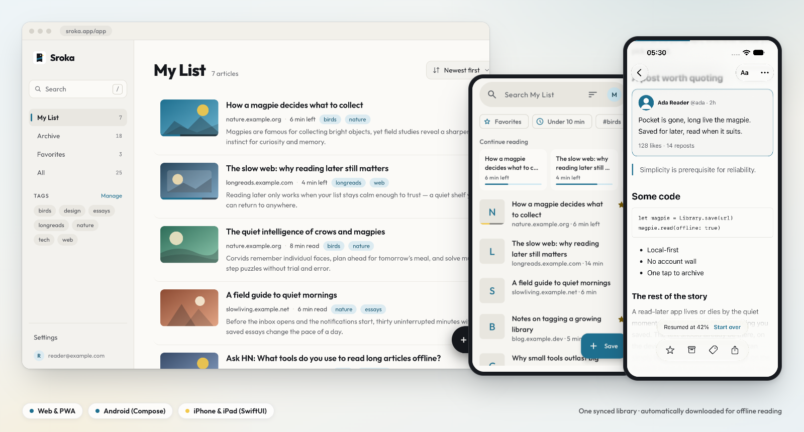
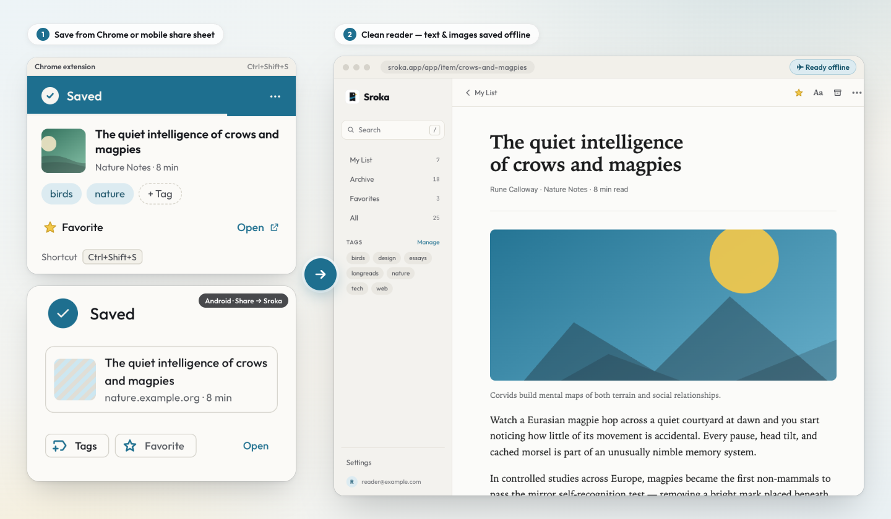
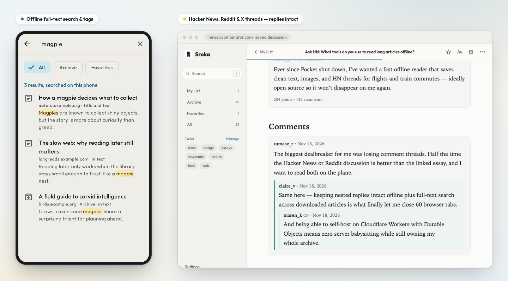
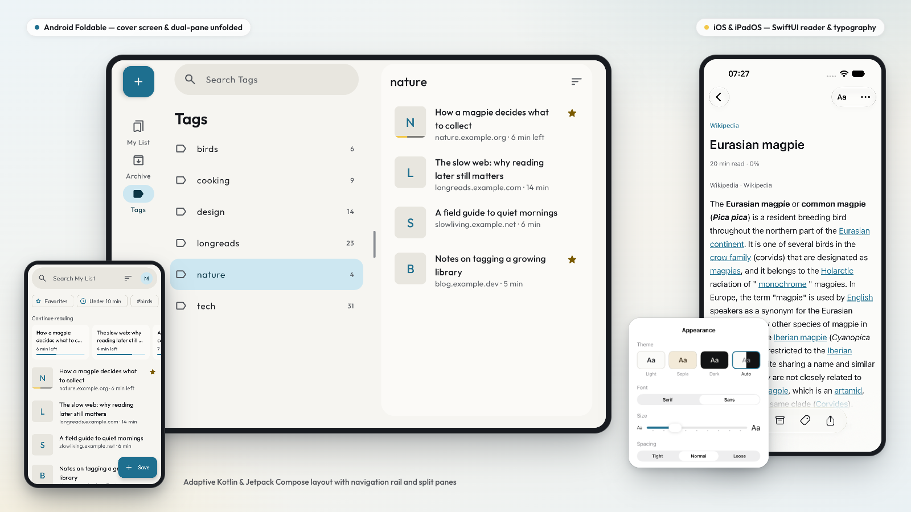
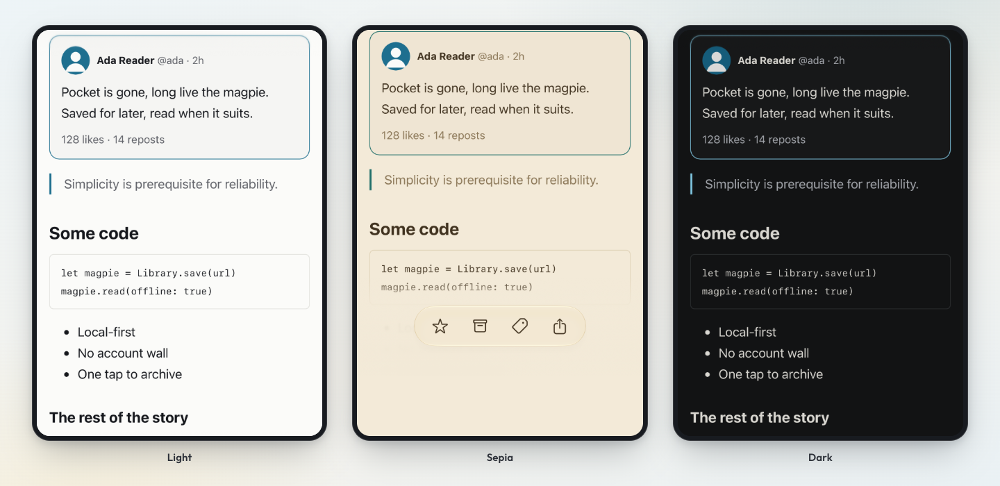
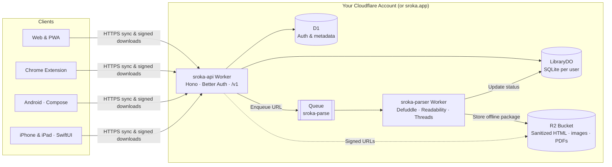

<p align="center"></p>

<h1 align="center">Sroka</h1>

<p align="center">
  <strong>Save it now.<br/>Read it later.</strong>
</p>

<p align="center">
  Save articles, threads, and PDFs from your browser or phone — sync everywhere, and read offline on Android, iPhone, and iPad on a plane, on a train, or anywhere without signal.<br/>
  A free, open-source alternative to Instapaper and Pocket (which shut down in 2025), hosted at <a href="https://sroka.app">sroka.app</a> or self-hosted on your own Cloudflare account.
</p>

<p align="center">
  <a href="https://sroka.app"><strong>Open web app</strong></a> ·
  <a href="https://chromewebstore.google.com/detail/mgeodllnkiehnjbdogljfjgdbadjdblh">Chrome extension</a> ·
  <a href="https://play.google.com/store/apps/details?id=app.sroka">Android</a> ·
  <a href="https://testflight.apple.com/join/7nKJUGwN">iPhone &amp; iPad beta</a>
</p>

<p align="center">
  <picture>
    <source media="(prefers-color-scheme: dark)" srcset="docs/readme/hero-dark.png" />
    <source media="(prefers-color-scheme: light)" srcset="docs/readme/hero-light.png" />
    
  </picture>
</p>

---

*Sroka* is Polish for **magpie** — the bird that spots shiny things and stashes them away. It's free, has no ads, never sells your reading history, and every line of code for the backend and clients lives in this repository.

## Save once. Read offline.

Click the magpie in Chrome (`Ctrl+Shift+S`, `⌘⇧S` on Mac), paste a link on the web, or tap **Share → Sroka** from any app on Android, iPhone, or iPad — browsers, newsletters, Reddit, Hacker News, X, or PDFs.

On the native Android and Apple apps, **saved means offline**: article text, images, and supported discussions download automatically (over Wi-Fi by default, configurable in Settings) so your reading list is waiting in airplane mode, subway tunnels, or anywhere without signal. Article reading position syncs across devices once you're back online.

<p align="center">
  
</p>

## Organize, search, and keep the discussion

- **Tags, favorites & archive.** Keep your queue focused with tags, stars, quick filters (*Under 10 min*, *Favorites*), and one-tap archiving.
- **On-device full-text search.** On Android, iPhone, and iPad, search matches inside the full text of your downloaded articles and archive — even offline.
- **Discussions & threads come along too.** Save a Hacker News story or Reddit post (best via the Chrome extension for full Reddit trees) to keep nested replies — or save an X thread stitched into one clean page with quoted posts and images.
- **PDFs alongside articles.** Drop a PDF on the web app or share one from your phone and keep it right next to your essays.

<p align="center">
  
</p>

> **Moving from Pocket or Instapaper?** Import your existing Pocket export, Instapaper export, or browser bookmarks right in Settings — and export your reading list as CSV or JSON whenever you like.

## Built for phones, foldables, and tablets

Sroka isn't a webview wrapper. Every client is built natively for its platform:

- **Android (Kotlin & Jetpack Compose):** Adaptive layouts that feel right at home on phones, folded cover screens, unfolded foldables, and tablets — with a navigation rail, split panes, and Material 3 design.
- **iPhone & iPad (SwiftUI, public beta):** Native share extension, iPad split view, and clean typography controls.
- **Calm, distraction-free reader:** Adjustable font, size, line spacing, and **Light**, **Sepia**, and **Dark** themes.

<p align="center">
  
</p>

<p align="center">
  
</p>

## Get Sroka

| Platform | Download |
|---|---|
| **Web & PWA** | [sroka.app](https://sroka.app) (installable as a PWA) |
| **Chrome** | [Chrome Web Store](https://chromewebstore.google.com/detail/mgeodllnkiehnjbdogljfjgdbadjdblh) |
| **Android** | [Google Play](https://play.google.com/store/apps/details?id=app.sroka) · signed APKs on [GitHub Releases](https://github.com/tajchert/sroka/releases) |
| **iPhone & iPad** | [TestFlight public beta](https://testflight.apple.com/join/7nKJUGwN) |

**Private by default:** Passwordless email one-time code sign-in, no ads, no tracking of what you read, analytics off until you opt in, and full account & data deletion anytime in Settings.

## Open source — and self-hostable on Cloudflare

Sroka is licensed under **Apache 2.0**. You can use the hosted instance at [sroka.app](https://sroka.app) for free, or deploy the exact same backend on your own [Cloudflare](https://developers.cloudflare.com/workers/) account and point the web app, Chrome extension, Android app, and iOS app at your server.

Everything runs serverless on Cloudflare's stack — no VPS to maintain:

- **API Worker (`sroka-api`)** — [Hono](https://hono.dev) + [Better Auth](https://www.better-auth.com), serving the web SPA and `/v1` sync API.
- **Durable Objects (`LibraryDO`)** — one SQLite-backed Durable Object per user with last-write-wins sync so mobile clients work seamlessly offline and catch up later.
- **Queue & Parser Worker (`sroka-parser`)** — asynchronously fetches and extracts pages ([Defuddle](https://github.com/kepano/defuddle) + [Readability](https://github.com/mozilla/readability) fallback, plus dedicated extractors for Hacker News, Reddit, and X), sanitizes HTML, and writes reading packages to **R2** behind signed URLs.
- **D1 & KV** — auth/shared metadata in D1, runtime config in KV.

A step-by-step self-hosting guide is on the roadmap; in the meantime, [`workers/api/wrangler.jsonc`](workers/api/wrangler.jsonc), [`workers/parser/wrangler.jsonc`](workers/parser/wrangler.jsonc), and [`docs/cloudflare-resources.md`](docs/cloudflare-resources.md) list every binding and secret required.

## Architecture



## Run it locally

Requires Node 26 (`nvm use`). The entire backend (API, parser, and web app) runs locally in one `wrangler dev` process — no Cloudflare account required.

```sh
nvm use
npm install
npm run dev:setup              # once: local secrets, local D1 database, web build
npm run dev -w @sroka/api      # http://localhost:8787 (API + parser + web)
npm run dev -w @sroka/web      # optional: Vite with hot reload on :5173
```

Sign in with any email address — locally, the one-time login code prints straight to the `wrangler dev` log.

```sh
npm run typecheck
npm test
```

<details>
<summary><strong>Repository layout &amp; client build commands</strong></summary>

| Path | What's inside |
|---|---|
| [`apps/web`](apps/web) | React web app (`/app`) and landing page |
| [`apps/extension`](apps/extension) | Chrome extension (WXT, Manifest V3) |
| [`apps/android`](apps/android) | Native Android app with its own Gradle build ([README](apps/android/README.md)) |
| [`apps/ios`](apps/ios) | Native iOS/iPadOS app &amp; share extension with its own Xcode project ([AGENTS.md](apps/ios/AGENTS.md)) |
| [`workers/api`](workers/api) | `sroka-api` Worker: auth, sync API, content delivery, static assets |
| [`workers/parser`](workers/parser) | `sroka-parser` Worker: queue consumer that extracts articles &amp; threads |
| [`packages/extractor`](packages/extractor) | Fetch, extraction, sanitization, and image packaging (Node &amp; Workers) |
| [`packages/shared`](packages/shared) | Zod schemas, sync op types, and URL normalizer shared across TS clients |

**Client builds:**
- **Extension:** `npm run build -w @sroka/extension`, then load `apps/extension/.output/chrome-mv3` as an unpacked extension.
- **Android:** from `apps/android` with JDK 21, run `./gradlew assembleDebug` (see [`apps/android/README.md`](apps/android/README.md)).
- **iOS / iPadOS:** `apps/ios/scripts/verify.sh all` (see [`apps/ios/AGENTS.md`](apps/ios/AGENTS.md)).
- **README screenshots:** `PW_CORE=<path-to-playwright-core> node store/scripts/readme-images.mjs` (after building `@sroka/web` and `@sroka/extension`).

**Specs &amp; docs:**
- [`docs/api.md`](docs/api.md) — HTTP and sync contract (start here if you're building a client)
- [`docs/decisions.md`](docs/decisions.md) — binding architecture decisions
- [`docs/sroka-system-design.md`](docs/sroka-system-design.md) — full system design

</details>

## Contributing

Bug reports and pull requests are welcome. Please open an [issue](https://github.com/tajchert/sroka/issues) first for anything larger than a small fix. Commits follow [Conventional Commits](https://www.conventionalcommits.org), and each workspace has its own `CLAUDE.md` or `README.md` with build and test commands.

Questions or feedback: [hello@sroka.app](mailto:hello@sroka.app).

## License

Apache License 2.0 — see [LICENSE](LICENSE). Redistributions and derivative works must keep the attribution in [NOTICE](NOTICE) (License section 4(d)).
