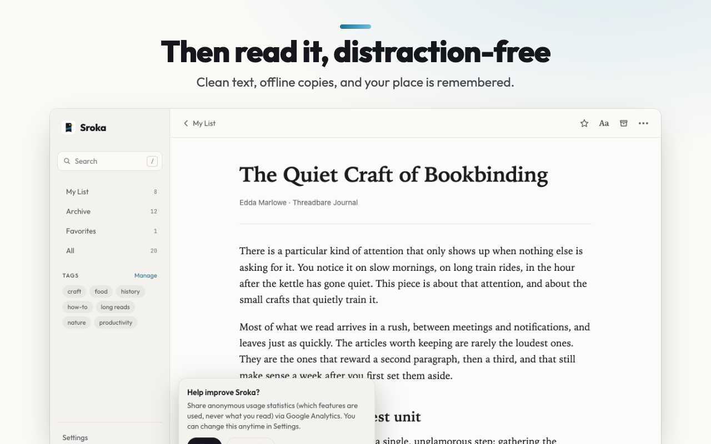
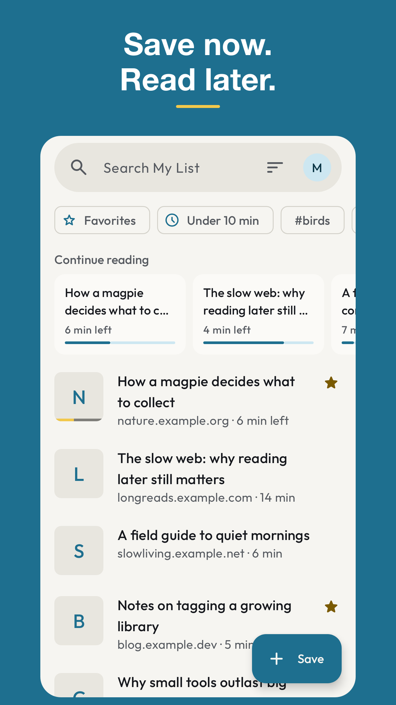
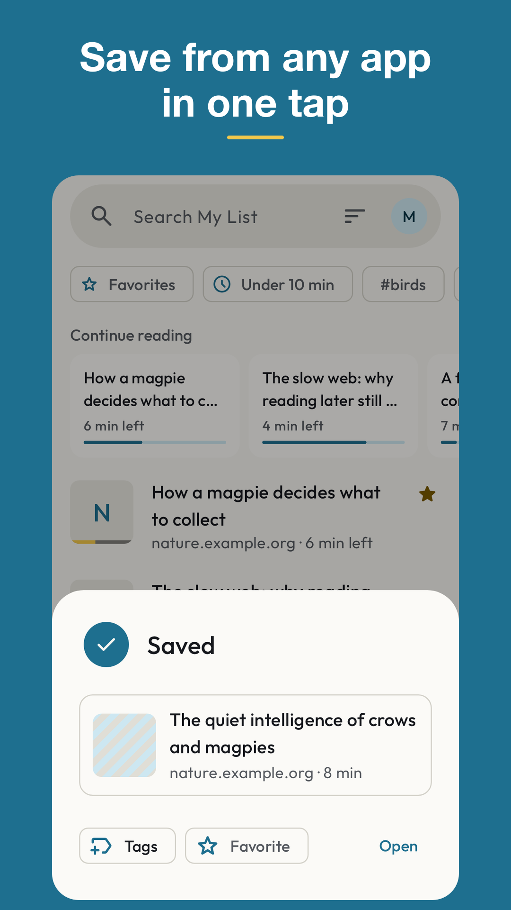
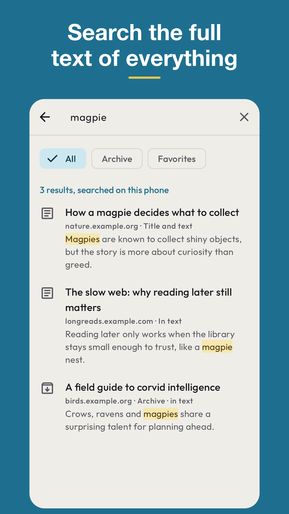
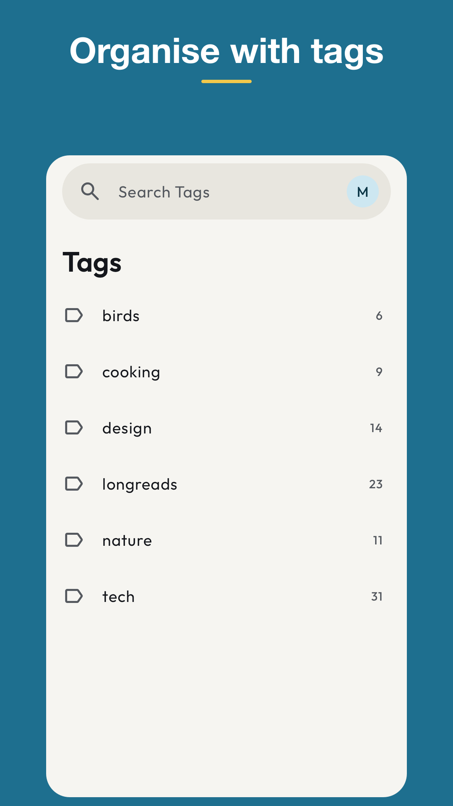
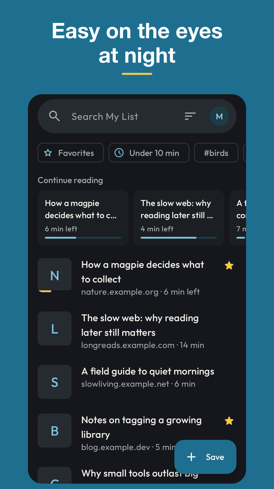
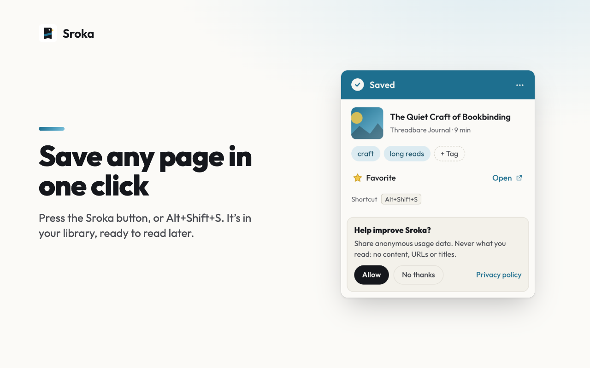
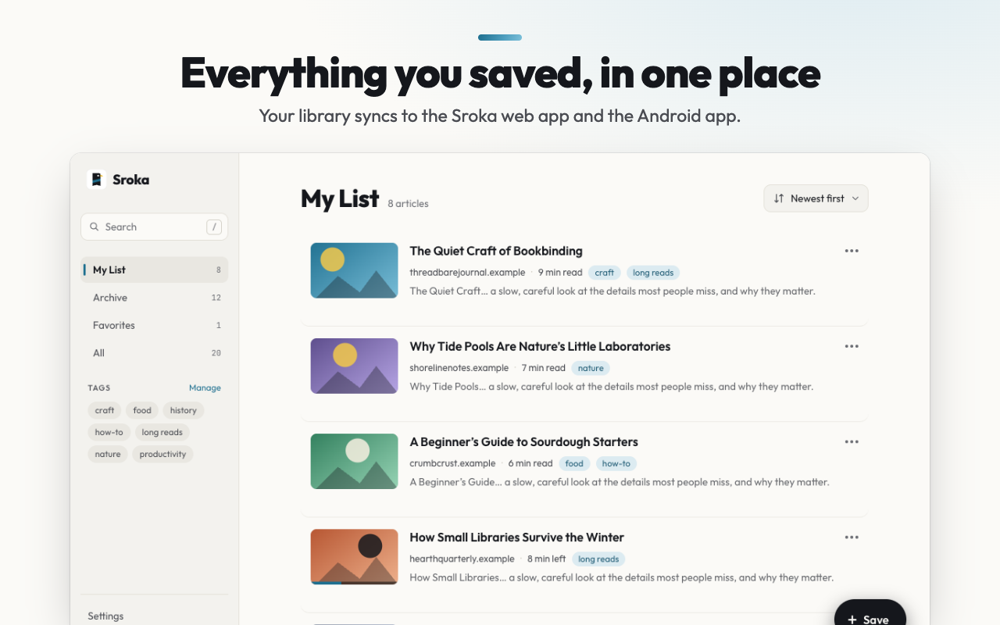
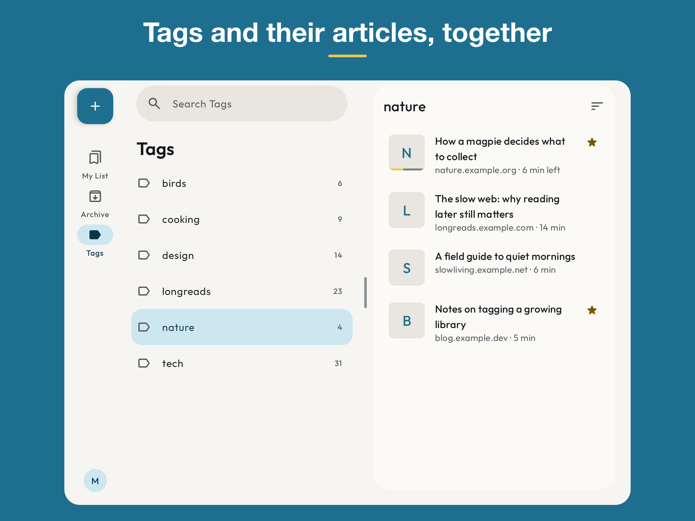
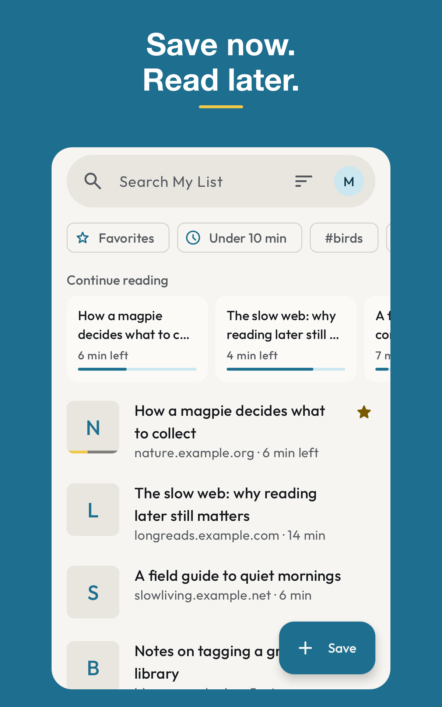

<p align="center"></p>

<h1 align="center">Sroka</h1>

<p align="center"><strong>Save it now. Read it later.</strong><br/>
An open-source read-later app: articles, threads and PDFs, read offline on any device.</p>

<p align="center">
  <a href="https://sroka.app">sroka.app</a> ·
  <a href="https://chromewebstore.google.com/detail/mgeodllnkiehnjbdogljfjgdbadjdblh">Chrome extension</a> ·
  <a href="https://play.google.com/store/apps/details?id=app.sroka">Android</a> ·
  <a href="https://testflight.apple.com/join/7nKJUGwN">iPhone &amp; iPad beta</a>
</p>

<p align="center">
  
  &nbsp;
  
</p>

---

Pocket shut down in 2025, and a lot of us lost the place where good articles waited for a quiet moment. Sroka (Polish for *magpie*, the bird that collects shiny things) is a replacement you can trust to stay around: it's free, it has no ads, and all of its code is in this repository.

## Why Sroka

- **Save in one tap.** Click the magpie in Chrome, or use *Share → Save to Sroka* on your phone. It works from the browser, Reddit, Hacker News, newsletters and chat apps.
- **Read offline.** Each saved article is downloaded with its text and images, so it's there on a train, on a plane or in a tunnel.
- **A calm reader.** You get clean text with adjustable type and light and dark themes. Your place in each article syncs across devices.
- **Comments are saved too.** Save a Reddit post, an X thread or a Hacker News story and Sroka keeps the whole discussion, every reply in its place.
- **PDFs as well.** Drop a PDF on the web app or share one from your phone. It sits in your list next to your articles.
- **Bring your library, take it with you.** Import from Pocket, Instapaper or browser bookmarks. Export everything as CSV or JSON whenever you want.
- **Private by default.** You sign in with your email and a one-time code, so there's no password. Nobody tracks what you read, and your data is never sold. Usage statistics stay off until you turn them on, and you can delete your account and all of its data from Settings.

## Screenshots

<p align="center">
  
  
  
  
</p>

<p align="center">
  
  
</p>

<p align="center">
  
  
</p>

## Get it

| Platform | |
|---|---|
| 🌐 Web | [sroka.app](https://sroka.app), also installable as a PWA |
| 🧩 Chrome | [Chrome Web Store](https://chromewebstore.google.com/detail/mgeodllnkiehnjbdogljfjgdbadjdblh) |
| 🤖 Android | [Google Play](https://play.google.com/store/apps/details?id=app.sroka), with signed APKs on [GitHub Releases](https://github.com/tajchert/sroka/releases) |
| 🍎 iPhone & iPad | [TestFlight public beta](https://testflight.apple.com/join/7nKJUGwN) |

## How it works

1. **Spot it.** Click the extension's toolbar icon, or share from any app.
2. **Stash it.** Sroka pulls out the article (text, images and, for threads, the comments) and adds it to your list.
3. **Read it.** The article downloads to every device you use and waits there, online or offline.

Under the hood, Sroka runs entirely on [Cloudflare](https://developers.cloudflare.com/workers/):

- The **API Worker** ([Hono](https://hono.dev), [Better Auth](https://www.better-auth.com)) serves the web app and the `/v1` sync API.
- Each user's library lives in its own **Durable Object**, with SQLite and last-write-wins sync, so clients can work offline and catch up later.
- A **parser Worker** reads a queue, fetches the page, extracts the article ([Defuddle](https://github.com/kepano/defuddle) with a [Readability](https://github.com/mozilla/readability) fallback, plus dedicated extractors for X, Reddit and Hacker News), sanitizes it and stores it in **R2** behind signed URLs.
- The clients are native: Kotlin and Compose on Android (with full foldable support), SwiftUI on iOS, React on the web and a WXT MV3 extension for Chrome.

## Repository layout

| Path | What's inside |
|---|---|
| [`apps/web`](apps/web) | React web app (`/app`) and landing page |
| [`apps/extension`](apps/extension) | Chrome extension (WXT, Manifest V3) |
| [`apps/android`](apps/android) | Native Android app with its own Gradle build ([README](apps/android/README.md)) |
| [`apps/ios`](apps/ios) | Native iOS/iPadOS app and share extension with its own Xcode project ([AGENTS.md](apps/ios/AGENTS.md)) |
| [`workers/api`](workers/api) | `sroka-api` Worker: auth, sync API, content, static assets |
| [`workers/parser`](workers/parser) | `sroka-parser` Worker: queue consumer that extracts articles |
| [`packages/extractor`](packages/extractor) | Fetch, extraction, sanitizing and image handling (runs in Node and Workers) |
| [`packages/shared`](packages/shared) | Zod schemas, sync operations and URL normalizer shared by every TS client |

More reading:
- [`docs/api.md`](docs/api.md): the HTTP and sync contract, which is the place to start if you're writing a client
- [`docs/decisions.md`](docs/decisions.md): binding design decisions
- [`docs/sroka-system-design.md`](docs/sroka-system-design.md): the full system design (long)

## Run it locally

You need Node 26 (`nvm use`). The whole backend runs locally in one `wrangler dev` process, with no Cloudflare account needed.

```sh
nvm use
npm install
npm run dev:setup              # once: local secrets, local D1 database, web build
npm run dev -w @sroka/api      # http://localhost:8787 (API + parser + web)
npm run dev -w @sroka/web      # optional: Vite with hot reload on :5173
```

Sign in with any email. Locally, the one-time code is printed in the `wrangler dev` log.

Checks:

```sh
npm run typecheck
npm test
```

- Extension: `npm run build -w @sroka/extension`, then load `apps/extension/.output/chrome-mv3` as an unpacked extension.
- Android: from `apps/android` with JDK 21, run `./gradlew assembleDebug`. See [`apps/android/README.md`](apps/android/README.md).
- iOS: `apps/ios/scripts/verify.sh all`. See [`apps/ios/AGENTS.md`](apps/ios/AGENTS.md).

Self-hosting on your own Cloudflare account works with the same Workers, but no step-by-step guide exists yet. [`workers/api/wrangler.jsonc`](workers/api/wrangler.jsonc) and [`docs/cloudflare-resources.md`](docs/cloudflare-resources.md) list the bindings you'd need.

## Contributing

Bug reports and pull requests are welcome. Please open an [issue](https://github.com/tajchert/sroka/issues) first for anything bigger than a small fix. Commits follow [Conventional Commits](https://www.conventionalcommits.org), and each workspace has a `CLAUDE.md` or `README.md` with its own build and test commands.

Questions or feedback: [hello@sroka.app](mailto:hello@sroka.app).

## License

Apache License 2.0, see [LICENSE](LICENSE). Redistributions and derivative works must keep the attribution in [NOTICE](NOTICE) (License section 4(d)).
