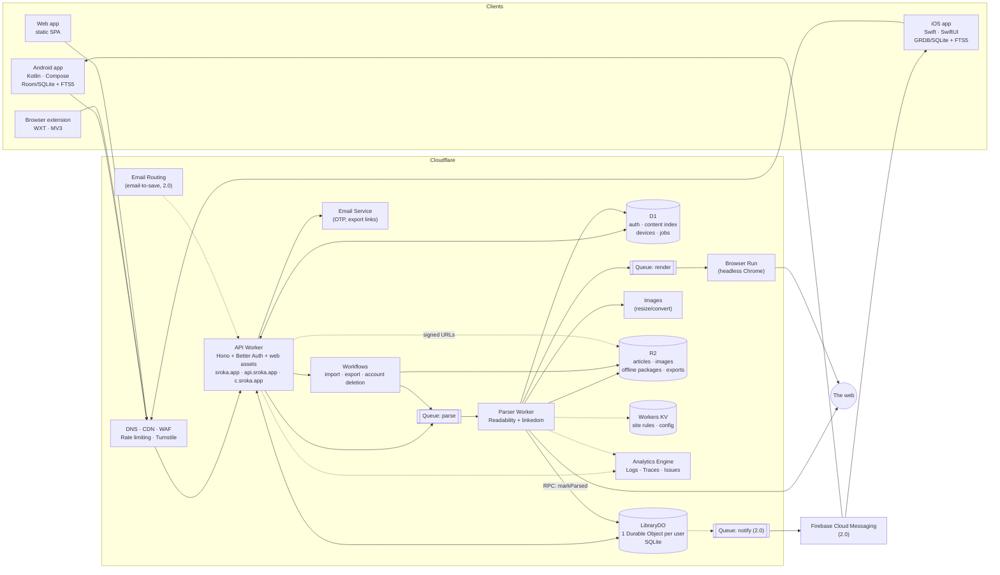
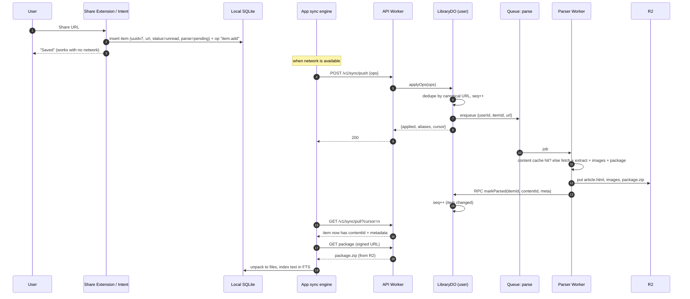
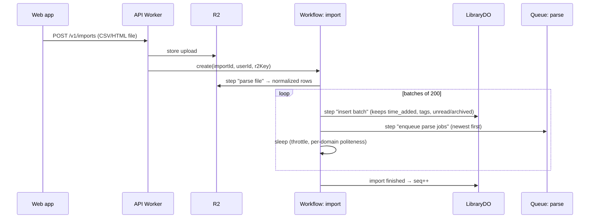
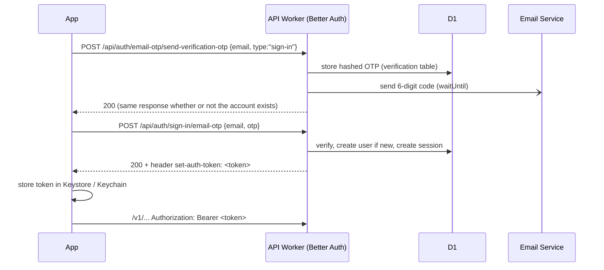

# Sroka — Read-Later App on Cloudflare: Research & System Design Draft

**Name:** **Sroka** (Polish for *magpie*, the bird that hoards shiny things) · **Domain:** [sroka.app](https://sroka.app)
**Status:** Draft v0.2 · 14 Oct 2026 (v0.2: name, domain and hostname plan)
**Scope:** open-source "save for later, read offline" app — native Android + iOS, browser extension, minimal web app, backend fully on Cloudflare. Auth with Better Auth (email OTP). FCM push from 2.0.

> Cloudflare product statuses, limits and prices below come from the attached *Building Backends on Cloudflare* guide (as of 1 Oct 2026). Re-check each product's `/platform/limits/` and `/platform/pricing/` pages before committing.

---

## Table of contents

1. [Pocket — what it was and what we learn from it](#1-pocket--what-it-was-and-what-we-learn-from-it)
2. [Product vision, principles & brand](#2-product-vision-principles--brand)
3. [Feature catalogue](#3-feature-catalogue)
4. [Architecture overview](#4-architecture-overview)
5. [Tech stack](#5-tech-stack)
6. [Core flows](#6-core-flows)
7. [Data model](#7-data-model)
8. [Sync protocol (offline-first)](#8-sync-protocol-offline-first)
9. [Content pipeline (parsing, images, offline packages)](#9-content-pipeline-parsing-images-offline-packages)
10. [Authentication (Better Auth + email OTP)](#10-authentication-better-auth--email-otp)
11. [API surface](#11-api-surface)
12. [Client design (Android, iOS, extension, web)](#12-client-design-android-ios-extension-web)
13. [Security, privacy, abuse](#13-security-privacy-abuse)
14. [Platform limits we design around](#14-platform-limits-we-design-around)
15. [Cost estimate](#15-cost-estimate)
16. [Observability & operations](#16-observability--operations)
17. [Repository layout & open-source / self-hosting](#17-repository-layout--open-source--self-hosting)
18. [Roadmap: 1.0, 2.0, future](#18-roadmap-10-20-future)
19. [Open questions](#19-open-questions)
20. [Sources](#20-sources)

---

## 1. Pocket — what it was and what we learn from it

### 1.1 Short history

| Date | Event |
|---|---|
| 2007 | Launched as **Read It Later** (renamed **Pocket** in 2012). |
| 2017 | Acquired by **Mozilla**; investment shifted toward content curation/recommendations (Firefox New Tab). |
| Apr 2023 | **Save-by-email** (`add@getpocket.com`) discontinued. |
| Nov 2024 | Competitor **Omnivore** (open source) shuts down after an acqui-hire. |
| 22 May 2025 | Shutdown announced; apps pulled from stores, extensions unavailable for install, sign-ups closed. |
| 8 Jul 2025 | Service shut down; web switched to export-only; annual subscriptions refunded pro rata. |
| 8 Oct 2025 | Export window closed; all accounts and data deleted; API stopped reading/writing. |

Mozilla's stated reason: people's habits of saving and consuming web content had changed, and it wanted to focus resources elsewhere (Firefox Tab Groups / bookmarks, recommendations). getpocket.com today is just a farewell page.

### 1.2 Pocket feature inventory

**Saving**
- Browser extension / toolbar button (Chrome, Firefox — built into Firefox — Safari, Edge); bookmarklet for other browsers.
- Mobile **share sheet** (iOS & Android) from any app — saved even while offline, uploaded later.
- Paste a URL on the website.
- **Email to save** (`add@getpocket.com`) — discontinued in 2023.
- Integrations from many third-party apps (Twitter clients, Flipboard, IFTTT/Zapier, Kobo e-readers) through a public API.

**Reading**
- Clean **article view** (reader mode) stripping ads and clutter.
- Typography controls: font, size, line height, margins; light/dark/sepia themes. Premium added 8 extra fonts.
- **Estimated reading time** per item.
- **Offline**: "if it's in Pocket, it's on your phone, tablet and computer — even offline".
- **Listen** (text-to-speech): hands-free playback of articles.
- Videos could be saved too (watch later).

**Organising**
- **My List** (unread) / **Archive** (read) / **Favorites**.
- **Tags** — unlimited, filter by tag; bulk edit.
- **Highlights** — free tier limited to 3 per article; unlimited in Premium.
- Search — basic (title/URL) on free; **full-text search** on Premium (keyword, topic, author, tag, multi-tag).
- Shareable **Lists/Collections** (later years) and sharing to friends.

**Premium ($4.99/mo or $44.99/yr)**
- **Permanent Library** — backed-up copy of every saved page, kept even if the original disappears.
- Full-text search, **suggested tags** (initially the 3 most recently used tags, getting smarter with usage), unlimited highlights, premium fonts, no sponsored posts.

**Discovery**
- Recommendations / "Pocket Hits" newsletter / Firefox New Tab stories — the part Mozilla kept.

**API (v3)** — useful reference design for our sync:
- `POST /v3/add`, `POST /v3/send` (batched actions: `add`, `archive`, `readd`, `favorite`, `unfavorite`, `delete`, `tags_add`, `tags_remove`, `tags_replace`, `tags_clear`, `tag_rename`), `POST /v3/get` with `state`, `favorite`, `tag`, `contentType`, `sort`, `search`, `domain`, `count/offset` and **`since`** (return only items modified after a timestamp — the incremental sync primitive).

**Export format** (relevant for import): CSV with `title, url, time_added (unix), tags (comma/pipe-separated), status (unread|archive/read)`; older exports were an HTML file (`ril_export.html`) with `<a href time_added tags>` links grouped into Unread / Read Archive.

### 1.3 Lessons → design decisions

| Observation | Our decision |
|---|---|
| Permanent library (stored copy) was a paid feature. | We must store a copy anyway to make offline work. R2 storage is cheap with zero egress → **permanent copy is the default for everyone**. |
| Two big read-later services (Omnivore, Pocket) died within 8 months and users scrambled to export. | **Data portability is a 1.0 feature**: one-click export (CSV + JSON + full HTML/Markdown archive). Open source + **one-command self-host on Cloudflare**. |
| Pocket importers are what every alternative built first. | **Pocket CSV/HTML import in 1.0** (plus Instapaper CSV, Netscape bookmarks HTML). |
| A common complaint: offline copies lost images/videos, leaving text only. | Download, resize and **package images** with the article for offline. |
| Server-side fetch fails on paywalled/logged-in/JS-heavy pages. | Extension can **send the page as rendered in your browser** ("save as you see it"); server falls back to **Browser Run** for JS-rendered pages. |
| Pocket drifted toward discovery/recommendations. | Stay focused on **save → read offline → find again**. No feed, no ads. |
| "Saved 500, read 30" problem. | Future: gentle resurfacing, reading-time-based queues ("fits in 10 min"), not more saving features. |
| Save-by-email was removed but people relied on it. | **Email-to-save** via Cloudflare Email Routing in 2.0 (cheap to run). |
| Free tier search only covered titles. | **On-device full-text search** over downloaded articles from 1.0 (works offline, costs nothing server-side). |

---

## 2. Product vision, principles & brand

**One-liner:** *Save anything from anywhere in one tap; it's on your phone, readable and searchable, with no signal.*

**Brand:** **Sroka** — the magpie collects shiny things and keeps them in its nest. The metaphor maps directly onto the product: you snatch articles while browsing and they wait for you in your library. Pronounced *SRO-kah*; short, easy to type, works internationally.

| Surface | Name / identifier |
|---|---|
| Product | Sroka |
| Website + web app | `https://sroka.app` |
| Mobile apps (store listing) | "Sroka — Read Later, Offline" |
| Bundle / package ID | `app.sroka` (iOS), `app.sroka` (Android) — share extension `app.sroka.share` |
| Browser extension | "Sroka — Save for later" |
| Verb in UI | "Save to Sroka" (toolbar tooltip, share sheet label) |
| Library name in UI | "Nest" is a playful option for the main list; keep "My List / Archive / Favorites" if clarity wins |
| CLI / self-host scaffold | `npm create sroka` |
| GitHub org / repo | `sroka-app/sroka` (check availability) |

Principles:
1. **Offline-first, not offline-capable.** The phone's local database is the source of truth for the UI. Network is a background concern. An expired session or 30 h without signal must never block reading.
2. **One tap to save, zero decisions.** Tags are optional and suggested.
3. **Your library is yours.** Export anything, any time. Self-hostable.
4. **Cheap to run.** Built so a hobby instance costs ~$5/month and 10k MAU costs tens of dollars.
5. **Boring, small native apps.** Native share integration, native background downloads, WebView-based reader.

---

## 3. Feature catalogue

Legend: **1.0** = MVP · **2.0** = next major · **F** = future/optional

| Area | Feature | Ver. |
|---|---|---|
| **Save** | Android share sheet target | 1.0 |
| | iOS Share Extension | 1.0 |
| | Browser extension (Chrome/Edge/Brave, Firefox incl. Firefox for Android): toolbar button, context-menu "save link", keyboard shortcut, tag-on-save | 1.0 |
| | "Save as you see it": extension captures rendered DOM for paywalled/logged-in pages | 1.0 |
| | Paste/add URL in app or web | 1.0 |
| | Save while offline (queued, uploaded later) | 1.0 |
| | Safari extension (macOS/iOS) | 2.0 |
| | Email-to-save (personal secret address) | 2.0 |
| | Newsletter inbox (email body itself becomes the article) | F |
| | RSS subscriptions → auto-save | F |
| | Save PDFs (store original, read offline) | 2.0 |
| **Read** | Clean reader view (sanitized HTML) | 1.0 |
| | Themes (light/dark/sepia/system), font family (3 bundled open fonts), size, line height, margins | 1.0 |
| | Estimated reading time, word count, site name, author, lead image | 1.0 |
| | Reading progress saved & synced across devices | 1.0 |
| | Open original / share original link | 1.0 |
| | Refresh article (re-parse) | 1.0 |
| | Listen — on-device TTS (offline, free), background audio, queue | 2.0 |
| | Listen — server-generated neural audio, downloadable | F |
| | AI summary (TL;DR) | F |
| **Offline** | Auto-download content of unread items (Wi-Fi only / any network / off) | 1.0 |
| | "Make everything available offline now" button (pre-flight) | 1.0 |
| | Per-item offline indicator, storage usage, storage cap, auto-evict archived content after N days; favorites pinned | 1.0 |
| | Silent push to pre-download new articles | 2.0 |
| **Organise** | My List / Archive / Favorites | 1.0 |
| | Tags: add, remove, rename, delete, filter; multi-tag filter | 1.0 |
| | Suggested tags: recent + frequent | 1.0 |
| | Suggested tags: AI (Workers AI) + auto-tag rules (domain → tag) | 2.0 |
| | Sort (newest, oldest, shortest, longest), filter by domain | 1.0 |
| | Bulk select: archive / tag / delete | 2.0 |
| | Highlights + notes; highlights list; export highlights to Markdown | 2.0 |
| | Collections / public shareable lists (links only) | F |
| **Find** | On-device full-text search (FTS5) incl. offline | 1.0 |
| | Server-side search for web/extension (title, URL, tags, excerpt) | 1.0 |
| | Server-side full-text search | 2.0 |
| | Semantic search / "related articles" / ask-your-library | F |
| **Account** | Email OTP sign-in (Better Auth) | 1.0 |
| | Delete account (required by App Store / Play) | 1.0 |
| | Sessions/devices list, sign out everywhere | 2.0 |
| | Passkeys, Sign in with Apple/Google | F |
| **Data** | Import: Pocket CSV + legacy HTML, Instapaper CSV, Netscape bookmarks HTML | 1.0 |
| | Import: Omnivore, Wallabag, Readwise, Raindrop | 2.0 |
| | Export: CSV (Pocket-compatible), JSON, full archive (HTML + Markdown + images, zip) | 1.0 |
| | Public API + personal API tokens | 2.0 |
| | MCP server ("search my reading list" for AI assistants) | F |
| **Notify** | FCM push: article ready / failed, import finished | 2.0 |
| | Optional weekly digest ("5 unread under 10 min") | 2.0 |
| **Platform** | Minimal web app (login, list, read, settings, import/export) | 1.0 |
| | Realtime updates on web/extension (WebSocket) | 2.0 |
| | Send to e-reader (EPUB export, Kobo/Kindle) | F |
| | Shared/family libraries | F |

### Non-goals for 1.0
Recommendations/discovery feed · social features · ads · highlights · TTS · AI anything · Safari extension · desktop apps.

---

## 4. Architecture overview

### 4.1 Big picture



### 4.2 Responsibilities

| Component | Product | Responsibility |
|---|---|---|
| **API Worker** | Workers (+ static assets) | REST API, Better Auth handler, routing requests to the user's `LibraryDO`, signed content URLs, serves the web SPA. Stateless. |
| **LibraryDO** | Durable Objects (SQLite) | One per user. Items, tags, reading state, change sequence, op idempotency log, server-side search index. **The sync authority.** |
| **D1** | D1 | Better Auth tables, global **content index** (dedupe parsed articles across users), device/FCM tokens, job records. |
| **Parser Worker** | Workers (queue consumer) | Fetch → extract → sanitize → images → package → store → notify `LibraryDO`. Separate Worker so its CPU/memory profile and deploys are isolated. |
| **parse / render queues** | Queues | Per-article jobs with retries + dead-letter queue. `render` is the slower headless-browser path. |
| **Browser Run** | Browser Run | Fallback for JS-rendered pages and sites blocking plain fetch. |
| **Images** | Images | Resize/convert article images (WebP/AVIF, max width) before packaging. |
| **R2** | R2 | Article HTML, images, offline packages (zip), raw captured HTML (private), user exports. Zero egress = cheap downloads to phones. |
| **KV** | Workers KV | Read-mostly global data: per-site extraction rules, URL-normalisation rules, app config/min app version. |
| **Workflows** | Workflows | Long, multi-step jobs: Pocket import (thousands of URLs, throttled), export archive build, account deletion. |
| **Email Service** | Email Service (beta) | OTP emails, "export ready" emails. Transactional only — exactly our use. Pluggable fallback (Resend/Postmark) for self-hosters. |
| **Email Routing** | Email Routing / Email Workers | 2.0: `save+<token>@in.sroka.app` → Worker → save. |
| **Edge security** | WAF, Rate Limiting, Turnstile | Protect OTP endpoints and save endpoints. |
| **Observability** | Workers Logs/Traces/Issues, Analytics Engine | Errors, traces, parse success rate per domain, product metrics. |

### 4.3 Why one Durable Object per user (instead of one big D1)

| Concern | LibraryDO per user | Single D1 for everything |
|---|---|---|
| Sync correctness | Single-threaded per user → a **monotonic change counter** is trivial and race-free. | Needs careful transactions; one writer for *all* users. |
| Write throughput | Scales horizontally (unlimited objects; ~1k req/s *per user* is plenty). | One writer thread per database; becomes the bottleneck. |
| Size | 10 GB per user (huge for metadata). | 10 GB for the whole service → sharding needed early. |
| Data residency | Can create the user's DO in the `eu` jurisdiction. | Whole DB in one jurisdiction. |
| Account deletion | `deleteAll()` on one object. | Many `DELETE … WHERE user_id`. |
| Realtime (2.0) | Same object holds WebSocket connections (hibernation = free when idle). | Needs a separate DO anyway. |
| Cross-user queries | ❌ Not possible → anything global (content dedupe, stats) lives in D1 / Analytics Engine. | ✅ |

D1 stays for things that **are** global or that Better Auth needs as a relational store.

### 4.4 Domains & hostnames (`sroka.app`)

The zone `sroka.app` lives on Cloudflare (DNS + proxy). `.app` is HSTS-preloaded, so everything is HTTPS-only by default — no extra work, and no way to accidentally serve HTTP.

| Hostname | Served by | Purpose |
|---|---|---|
| `sroka.app` | API Worker (static assets) | Landing page, web app (`/app`), privacy policy, `/.well-known/` files for app links |
| `api.sroka.app` | API Worker | REST API `/v1/*` and Better Auth `/api/auth/*`. Separate host keeps cookies, CORS and WAF rules simple. |
| `c.sroka.app` | API Worker (content route) | Signed article/package/image delivery from R2. **Separate, cookieless origin** so untrusted article HTML shown in the web reader can never touch `sroka.app` cookies or storage. |
| `in.sroka.app` | Email Routing → Email Worker | 2.0: email-to-save (`save+<token>@in.sroka.app`). A subdomain keeps its MX records apart from any human mailbox on the apex. |
| `staging.sroka.app`, `api.staging.sroka.app` | Staging Workers | Pre-production; protected with Cloudflare Access. |

**Email:** OTP and transactional mail sent from `noreply@sroka.app` via Email Service (SPF/DKIM set up automatically); add a DMARC record (`p=quarantine` once delivery is verified). Optional human address `hello@sroka.app` via Email Routing forward.

**App links / universal links:** `https://sroka.app/.well-known/apple-app-site-association` and `/.well-known/assetlinks.json` so links like `https://sroka.app/i/{itemId}` open the native app (reader) when installed, the web app otherwise.

**Self-hosters** replace these with their own hostnames via `wrangler.jsonc` vars (`APP_ORIGIN`, `API_ORIGIN`, `CONTENT_ORIGIN`); apps and extension take the server URL from settings.

---

## 5. Tech stack

### 5.1 Backend (TypeScript, Cloudflare Workers)

| Concern | Choice | Notes |
|---|---|---|
| HTTP framework | **Hono** + `@hono/zod-openapi` | Typed routes; generates **OpenAPI** → Kotlin/Swift client generation. |
| Validation / shared types | **Zod** in `packages/shared` | Same schemas for API, extension and web. |
| Auth | **Better Auth** + plugins `emailOTP`, `bearer` (+ `expo` not needed for pure native) | D1 via **Drizzle adapter** (`provider: "sqlite"`) — Better Auth has no direct D1 adapter. |
| ORM / migrations | **Drizzle** (D1 + DO SQLite) | `drizzle-kit generate` → `wrangler d1 migrations apply`. DO migrations run in the object constructor (`blockConcurrencyWhile`). |
| Article extraction | **@mozilla/readability** (Firefox Reader Mode engine) on **linkedom** | `jsdom` doesn't run in Workers; linkedom does. |
| HTML sanitising | Allowlist sanitizer on linkedom (or `HTMLRewriter` for streaming passes) | Strip scripts, styles, iframes, event handlers, tracking pixels. |
| HTML → Markdown | Small DOM walker (for export) | |
| Zip | **fflate** | Build offline packages and export archives (streaming, within 128 MB). |
| IDs | **UUIDv7** (client-generated) | Time-ordered, offline-safe. |
| Testing | Vitest + `@cloudflare/vitest-pool-workers`, Miniflare (`wrangler dev`) | |
| CLI / deploy | Wrangler, GitHub Actions | `cf` CLI is beta — not yet. |

### 5.2 Clients

| Client | Stack | Local storage | Background work |
|---|---|---|---|
| **Android** | Kotlin, Jetpack Compose, Ktor/OkHttp, kotlinx.serialization | Room (SQLite) + FTS5 table; files in app-private storage | WorkManager (constraints: unmetered network, battery not low) |
| **iOS** | Swift, SwiftUI, URLSession | GRDB (SQLite + FTS5); App Group container shared with Share Extension | BGTaskScheduler (refresh + processing), background `URLSession` downloads |
| **Extension** | **WXT** (MV3, cross-browser), TypeScript, Preact/Svelte popup | `chrome.storage.local` (token, pending saves) | Service worker, retry queue |
| **Web** | Small SPA (e.g. SolidJS/Svelte/React — pick one), served as Workers static assets | none (online only in 1.0) | — |

**Option — shared core via Kotlin Multiplatform:** the hardest client code (sync engine, op queue, conflict rules, DB schema via SQLDelight, API client) is identical on both platforms. Writing it once in KMP while keeping UIs fully native (Compose / SwiftUI) cuts the most bug-prone part in half. Recommended if you're comfortable with Kotlin; otherwise two native implementations against a well-specified protocol (§8) is fine.

### 5.3 Reader rendering
Both apps render articles in a **WebView** (Android `WebView`, iOS `WKWebView`) from local files, with an app-supplied CSS theme and a tiny JS bridge (progress, link taps, later highlights). JavaScript in article content is never executed (sanitized server-side; CSP `script-src 'self'` for the bridge only). This gives identical typography on both platforms and makes highlights (2.0) much easier.

---

## 6. Core flows

### 6.1 Save from phone (possibly offline)



### 6.2 Save from browser extension
1. Click toolbar button (or context menu / shortcut).
2. Popup shows "Saved ✓" immediately + optional tag field with suggestions.
3. Extension calls `POST /v1/items` with `{url, title}`; if "save as you see it" is enabled (or the page looks paywalled/logged-in), it also sends the **gzipped rendered HTML** (`document.documentElement.outerHTML`, ≤5 MB).
4. Captured HTML is stored privately (`raw/{userId}/{itemId}.html.gz`) and parsed with the same pipeline; result is **never shared** across users.
5. If offline/failed, it's queued in `chrome.storage` and retried.

### 6.3 Reading offline (airplane / train)
- Before the trip: app has already auto-downloaded unread items on Wi-Fi; user can tap **"Make all available offline"** to force it now.
- In the air: everything reads from local files; progress, archive, favorite, tag changes are written to local DB + op queue.
- On landing: sync engine pushes ops, pulls changes, downloads new packages.

### 6.4 Pocket import

Items appear in the list immediately with title/URL/tags/dates from the export; content fills in as parsing completes (newest/unread first so the useful part is ready quickly). A 5,000-item import is a single Workflow instance with ~25 batch steps — far under step limits.

### 6.5 Export
`POST /v1/exports {format: csv|json|archive}` → Workflow streams items from the DO, writes CSV/JSON (Pocket-compatible columns) or a zip with `index.html`, one folder per article (`article.html`, `article.md`, `img/`), uploads to R2, emails a signed download link (valid 7 days), deletes the file after 7 days (R2 lifecycle rule).

---

## 7. Data model

### 7.1 LibraryDO (per user, SQLite)

```sql
-- monotonic change counter for sync
CREATE TABLE meta (k TEXT PRIMARY KEY, v TEXT);          -- 'seq', 'schema_version'

CREATE TABLE items (
  id              TEXT PRIMARY KEY,      -- uuidv7 (client-generated)
  url             TEXT NOT NULL,         -- as saved
  canonical_url   TEXT NOT NULL,         -- normalized (no utm_*, fbclid, fragments…)
  url_hash        TEXT NOT NULL,         -- sha256(canonical_url) for dedupe
  title           TEXT,
  excerpt         TEXT,
  site_name       TEXT,
  author          TEXT,
  lang            TEXT,
  lead_image      TEXT,                  -- R2 key of thumbnail
  word_count      INTEGER,
  reading_minutes INTEGER,
  content_id      TEXT,                  -- -> D1 content / R2 prefix (null until parsed)
  content_private INTEGER DEFAULT 0,     -- 1 if from captured HTML
  parse_status    TEXT NOT NULL DEFAULT 'pending', -- pending|ok|partial|failed
  parse_error     TEXT,
  status          TEXT NOT NULL DEFAULT 'unread',  -- unread|archived
  is_favorite     INTEGER NOT NULL DEFAULT 0,
  progress        REAL DEFAULT 0,        -- 0..1
  progress_anchor INTEGER,               -- paragraph index (font-size independent)
  saved_at        INTEGER NOT NULL,      -- ms; Pocket import keeps time_added
  archived_at     INTEGER,
  last_read_at    INTEGER,
  deleted_at      INTEGER,               -- tombstone
  source          TEXT,                  -- share|extension|web|import|email
  clock           TEXT NOT NULL,         -- JSON: per-field HLC timestamps for LWW
  seq             INTEGER NOT NULL       -- last change seq
);
CREATE UNIQUE INDEX items_url ON items(url_hash) WHERE deleted_at IS NULL;
CREATE INDEX items_seq ON items(seq);
CREATE INDEX items_list ON items(status, saved_at DESC);

CREATE TABLE tags (
  id TEXT PRIMARY KEY, name TEXT NOT NULL COLLATE NOCASE,
  created_at INTEGER, deleted_at INTEGER, seq INTEGER NOT NULL
);
CREATE UNIQUE INDEX tags_name ON tags(name) WHERE deleted_at IS NULL;

CREATE TABLE item_tags (
  item_id TEXT, tag_id TEXT,
  present INTEGER NOT NULL,      -- 1 added, 0 removed (LWW per pair)
  at INTEGER NOT NULL,           -- HLC
  seq INTEGER NOT NULL,
  PRIMARY KEY (item_id, tag_id)
);

-- idempotency for pushed ops (pruned after 30 days by alarm)
CREATE TABLE applied_ops (op_id TEXT PRIMARY KEY, applied_at INTEGER);

-- server-side search for web/extension (1.0: metadata only; 2.0: full text)
CREATE VIRTUAL TABLE items_fts USING fts5(title, excerpt, site_name, tags, content='');

-- 2.0
CREATE TABLE highlights (
  id TEXT PRIMARY KEY, item_id TEXT NOT NULL,
  quote TEXT, prefix TEXT, suffix TEXT,   -- W3C text-quote selector
  start_par INTEGER, note TEXT, color TEXT,
  created_at INTEGER, deleted_at INTEGER, clock TEXT, seq INTEGER NOT NULL
);
```
> Verify FTS5 availability in Durable Object SQLite before relying on it; fallback is `LIKE` over title/excerpt (fine for a personal library) or a D1-side index.

### 7.2 D1 (global)

```sql
-- Better Auth: user, session, account, verification (generated by Better Auth CLI → Drizzle schema)

CREATE TABLE content (                 -- shared parse cache (public pages only)
  id             TEXT PRIMARY KEY,     -- random uuidv7 (NOT derived from URL)
  url_hash       TEXT NOT NULL,
  canonical_url  TEXT NOT NULL,
  parser_version INTEGER NOT NULL,
  status         TEXT NOT NULL,        -- ok|partial|failed
  title TEXT, word_count INTEGER, lang TEXT,
  bytes          INTEGER,              -- package size
  ref_count      INTEGER DEFAULT 0,    -- approx; reconciled by cron
  parsed_at      INTEGER NOT NULL
);
CREATE INDEX content_url ON content(url_hash, parser_version, parsed_at DESC);

CREATE TABLE devices (                 -- 2.0 push
  id TEXT PRIMARY KEY, user_id TEXT NOT NULL, platform TEXT,
  fcm_token TEXT, app_version TEXT, last_seen INTEGER
);

CREATE TABLE jobs (                    -- imports/exports status for UI
  id TEXT PRIMARY KEY, user_id TEXT, kind TEXT, status TEXT,
  total INTEGER, done INTEGER, error TEXT, created_at INTEGER, updated_at INTEGER
);
```

### 7.3 R2 layout

```
content/{contentId}/article.html          sanitized HTML (img src → img/{hash}.webp)
content/{contentId}/text.txt              plain text (search, TTS, word count)
content/{contentId}/img/{sha256}.webp     resized images
content/{contentId}/thumb.webp            list thumbnail
content/{contentId}/package.zip           offline package (manifest.json + article.html + img/*)
private/{userId}/{contentId}/...          same layout for captured (non-shareable) content
raw/{userId}/{itemId}.html.gz             captured HTML from extension (deleted after parse + 30 d)
uploads/{userId}/{importId}.csv           import files (lifecycle: 7 d)
exports/{userId}/{exportId}.zip           export files (lifecycle: 7 d)
```

Keys are written once (content-addressed / versioned) — this avoids R2's 1 write/s per key limit and lets us mark responses `immutable`.

**Offline package `manifest.json`:**
```json
{
  "format": 1,
  "contentId": "0192f3c4-…",
  "parserVersion": 3,
  "title": "…", "byline": "…", "siteName": "…", "lang": "en",
  "wordCount": 2310, "readingMinutes": 10,
  "files": [
    {"path": "article.html", "sha256": "…", "bytes": 48211},
    {"path": "img/9f2c….webp", "sha256": "…", "bytes": 81233}
  ]
}
```

---

## 8. Sync protocol (offline-first)

### 8.1 Model
- Every client keeps a full local copy of **metadata** for the whole library (small: ~1–2 KB/item) and **content** for a configurable subset.
- Clients never edit rows directly against the server; they record **operations** locally and push them. The server (`LibraryDO`) applies ops and assigns each changed row a new **`seq`** from a per-user monotonic counter.
- Clients pull with a **cursor** = last seen `seq` (same idea as Pocket's `since`, but a counter instead of wall-clock time — no clock-skew bugs, no missed updates).

### 8.2 Push
`POST /v1/sync/push`
```json
{
  "deviceId": "dev_0192…",
  "ops": [
    {"opId":"0192…a1","type":"item.add","itemId":"0192…","at":1760400723120,
     "url":"https://example.com/post?utm_source=x","title":"Optional","tags":["travel"],"source":"share"},
    {"opId":"0192…a2","type":"item.setStatus","itemId":"0192…","status":"archived","at":1760400800000},
    {"opId":"0192…a3","type":"item.setFavorite","itemId":"0192…","value":true,"at":1760400801000},
    {"opId":"0192…a4","type":"item.setProgress","itemId":"0192…","progress":0.42,"anchor":17,"at":1760400802000},
    {"opId":"0192…a5","type":"item.tag","itemId":"0192…","tag":"to-cook","present":true,"at":1760400803000},
    {"opId":"0192…a6","type":"tag.rename","from":"ml","to":"machine-learning","at":1760400804000},
    {"opId":"0192…a7","type":"item.delete","itemId":"0192…","at":1760400805000},
    {"opId":"0192…a8","type":"item.refresh","itemId":"0192…","at":1760400806000}
  ]
}
```
Response:
```json
{ "applied": ["0192…a1", "…"], "rejected": [{"opId":"…","reason":"unknown_item"}],
  "aliases": {"0192…localId": "0192…existingId"}, "cursor": 18423 }
```

Rules:
- **Idempotent:** `opId` stored in `applied_ops`; replays are no-ops (safe retries on flaky networks).
- **Batching:** ≤500 ops per request; client retries with exponential backoff.
- **Duplicate saves** (same canonical URL saved on two devices offline): server keeps the existing item, merges tags (union), moves it back to unread with a fresh `saved_at` (Pocket's "re-add" semantics), and returns an **alias** so the client merges its local row.

### 8.3 Pull
`GET /v1/sync/pull?cursor=18000&limit=500`
```json
{
  "cursor": 18423, "hasMore": false,
  "items":  [ { "id":"…", "title":"…", "status":"unread", "contentId":"…", "parseStatus":"ok", "tags":["travel"], "progress":0.42, "seq":18410, … } ],
  "tags":   [ { "id":"…", "name":"travel", "seq":18399 } ],
  "deleted":{ "items":["…"], "tags":["…"] }
}
```
- First sync = pull with `cursor=0` paged until `hasMore=false`.
- Tombstones are kept 180 days; a client whose cursor is older than the tombstone horizon gets `410 resync_required` and does a full re-pull (merging local pending ops first).

### 8.4 Conflict resolution
- **Per-field last-writer-wins** using a **hybrid logical clock** (`at` = client time, server clamps values >5 min in the future to server time; ties broken by `deviceId`). Works well here because conflicts are rare and low-stakes (one person, several devices).
- **Tags on items:** LWW per `(item, tag)` pair → add on phone + remove on laptop resolves deterministically, no lost tags.
- **Delete wins** over concurrent edits (tombstone), except an explicit later `item.add` of the same URL (re-save).
- **Progress:** LWW (not max) — re-reading from the top is a legitimate state.

### 8.5 When does the client sync?
App foreground, after any local change (debounced 2 s), pull-to-refresh, periodic background work (Android WorkManager ~15 min min; iOS BGAppRefresh best-effort), and (2.0) on FCM data/silent push. Web/extension: on open + (2.0) WebSocket "changed" pings from the DO.

### 8.6 Content download policy (client)
1. After pull, enqueue downloads for items with `contentId` and `status=unread` (+ favorites), newest first.
2. Constraints from settings: Wi-Fi only (default) / any network / manual.
3. Storage cap (default 1 GB); evict archived content older than N days, then LRU; favorites pinned.
4. Download = one `package.zip` per article from a signed URL → verify sha256s → unpack to `articles/{itemId}/` → index `text` into local FTS5.

---

## 9. Content pipeline (parsing, images, offline packages)

### 9.1 Parser Worker steps (queue consumer)

1. **Normalize URL** — lowercase host, strip fragments and tracking params (`utm_*`, `fbclid`, `gclid`, `mc_eid`, …; rules in KV), resolve AMP → canonical where possible.
2. **Cache lookup (public content only)** — D1 `content` by `url_hash` with current `parser_version` and age < 7 days → attach existing `contentId` to the item and stop. Popular articles get parsed once for everyone.
3. **Fetch** — `fetch()` with 15 s timeout, ≤5 redirects, `http(s)` only, response size cap 5 MB (streamed), identifying `User-Agent`. Reject private/loopback targets and our own hostnames.
4. **Type dispatch** — `text/html` → extract; `application/pdf` → store original (2.0 reader); images → store as single-image article; YouTube/Vimeo → metadata via oEmbed (link-only item).
5. **Extract** — linkedom DOM → **Readability** → title, byline, siteName, lang, published time, content HTML, text. Per-site rules from KV (selectors to remove/keep, multi-page "next" links).
6. **Fallback to Browser Run** — if extraction failed, text < ~500 chars on a page that looks like an SPA, or the site blocks plain fetch: enqueue to `render` queue → Browser Run returns rendered HTML → repeat step 5. Results are flagged `partial` if still poor ("Open original" offered).
7. **Sanitize** — allowlist tags/attributes; drop scripts, styles, forms, iframes (replace embeds with link cards), tracking pixels (1×1 images, known tracker hosts).
8. **Images** — up to 50 images/article, ≤10 MB each (streamed, never fully buffered alongside the DOM); transform via Images to WebP, max 1600 px wide; thumbnail 400 px. Rewrite `src` to `img/{sha256}.webp`; drop `srcset`.
9. **Package** — `article.html`, `text.txt`, `manifest.json`, images → `package.zip` (fflate, stored-not-deflated for images).
10. **Persist** — R2 objects → D1 `content` row → RPC `LibraryDO.markParsed(itemId, contentId, meta)`; DO bumps `seq` (and in 2.0 enqueues a push notification).
11. **Failure** — queue retries with backoff (3×); then DLQ consumer calls `markParsed(…, failed, reason)`. User can "Retry" (`item.refresh`) or open the original.

**Parser versioning:** every package records `parser_version`. Improving the parser doesn't rewrite old saves (they're a permanent snapshot); users can "Refresh article" to get a new version.

**Politeness:** imports throttle per domain (Workflow sleeps between batches; queue consumer concurrency capped). A per-domain token bucket in a small `DomainThrottleDO` is a 2.0 improvement if needed.

### 9.2 Serving content
- Clients get **signed URLs** in sync responses or via `GET /v1/items/{id}/content-url`: `https://c.sroka.app/{contentId}/package.zip?exp=…&sig=HMAC(userId,contentId,exp)`.
- A small route in the API Worker (bound to `c.sroka.app`, a cookieless origin) verifies the signature and streams from R2. Public content: `Cache-Control: public, max-age=31536000, immutable` (cache key includes the signature, so it's effectively per-user per-day). Private captured content: `private, no-store` at the CDN.
- Content IDs are random (not URL hashes) so nobody can probe "has someone saved this URL?".

### 9.3 Garbage collection
`LibraryDO` increments/decrements `content.ref_count` in D1 on attach/detach (delete item, refresh). Counts can drift (not transactional across DO+D1), so a weekly Cron Trigger reconciles and deletes R2 prefixes with `ref_count = 0` older than 30 days.

---

## 10. Authentication (Better Auth + email OTP)

### 10.1 Setup
- Better Auth mounted in the API Worker at `/api/auth/*`, database = D1 via **Drizzle adapter** (`provider: "sqlite"`).
- Plugins: **`emailOTP`** (passwordless sign-in; unknown emails auto-register — set `disableSignUp: true` if you ever want invite-only) and **`bearer`** (native apps & extension send `Authorization: Bearer …` instead of cookies). Web app uses cookies.
- `emailOTP` options: `otpLength: 6`, `expiresIn: 300`, `allowedAttempts: 5`, `storeOTP: "hashed"`, `resendStrategy: "rotate"`.
- `sendVerificationOTP` sends through **Cloudflare Email Service** binding; call it with `ctx.waitUntil(…)` instead of awaiting (Better Auth recommends not awaiting to avoid timing attacks).
- Sessions: long-lived and rolling (e.g. 90 days, refreshed on use) — readers may be offline for days.

### 10.2 Flow (native app)



### 10.3 Details that matter
- **iOS Share Extension** reads the token from a **shared Keychain access group** (App Group) so saving works without opening the app.
- **401 never wipes local data.** The app keeps working offline with pending ops; it asks for a new code only when it's online and needs the server.
- **Abuse:** WAF rate-limiting rule on `/api/auth/email-otp/*` (per IP), plus Better Auth's own rate limiter, plus a per-email cooldown (60 s) and daily cap. **Turnstile** on the web login form (verified server-side via `siteverify`). Mobile apps rely on rate limits (+ optionally Play Integrity / App Attest later).
- **App Store / Play review:** reviewers can't receive your OTP email → configure a review account email with a fixed code via a custom `generateOTP` restricted to that single address (env-configured, disabled for self-hosters).
- **Session validation cost:** each API request validates the bearer token against D1. Optimisation if needed: cache `tokenHash → userId` in the Cache API for 60 s (trade-off: sign-out takes up to 60 s to apply).
- **Account deletion:** `DELETE /v1/account` → Workflow: delete `LibraryDO` storage (`deleteAll`), private R2 prefixes, uploads/exports, devices, Better Auth rows; decrement shared content refs.

---

## 11. API surface

Base URL `https://api.sroka.app`. All under `/v1`, JSON, bearer or cookie auth. OpenAPI spec published from Hono at `https://api.sroka.app/openapi.json`.

| Method & path | Purpose | Ver. |
|---|---|---|
| `/api/auth/*` | Better Auth (OTP send, sign-in, session, sign-out) | 1.0 |
| `POST /v1/items` | Quick save `{url, title?, tags?, html?}` (extension/web) → `202 {item}` | 1.0 |
| `GET /v1/items?state=&tag=&q=&sort=&cursor=` | List/search (web, extension) | 1.0 |
| `GET /v1/items/{id}` | Item detail | 1.0 |
| `GET /v1/items/{id}/content-url` | Signed URL(s) for package / article.html | 1.0 |
| `POST /v1/sync/push` | Apply ops | 1.0 |
| `GET /v1/sync/pull?cursor=&limit=` | Changes since cursor | 1.0 |
| `GET /v1/tags` | Tags with counts | 1.0 |
| `POST /v1/imports` · `GET /v1/imports/{id}` | Start import / progress | 1.0 |
| `POST /v1/exports` · `GET /v1/exports/{id}` | Start export / status + link | 1.0 |
| `DELETE /v1/account` | Delete account | 1.0 |
| `GET /v1/config` | Min app version, feature flags (from KV) | 1.0 |
| `GET https://c.sroka.app/{contentId}/{file}?exp&sig` | Signed content delivery from R2 | 1.0 |
| `POST /v1/devices` · `DELETE /v1/devices/{id}` | Register FCM token | 2.0 |
| `GET /v1/ws` | WebSocket to LibraryDO (change pings) | 2.0 |
| `POST /v1/tokens` | Personal API tokens (Better Auth API-key plugin) | 2.0 |

The web app and the extension mostly use `/v1/items`; native apps mostly use `sync/*`.

---

## 12. Client design (Android, iOS, extension, web)

### 12.1 Mobile app screens (1.0)
- **Sign in:** email → 6-digit code (auto-fill from email on iOS where possible).
- **My List** (default) · **Archive** · **Favorites** · **Tags** — list with thumbnail, title, site, reading time, offline badge; swipe to archive/favorite.
- **Reader:** WebView, top bar (back, tags, favorite, archive, share, ⋯), typography sheet, progress bar.
- **Search:** local FTS5 with results highlighting; works offline.
- **Settings:** offline downloads (Wi-Fi only/any/manual), storage cap, "Download all now", theme/fonts defaults, import/export (opens web), account (sign out, delete).

### 12.2 Android specifics
- Share target: `ACTION_SEND` with `text/plain`; extract the first URL from shared text (many apps share "Title https://…").
- Writes item + op to Room immediately, then schedules an expedited `WorkManager` sync.
- Downloads: `CoroutineWorker` with `NetworkType.UNMETERED` (or `CONNECTED`), `setRequiresBatteryNotLow`.
- Token in Android Keystore-backed EncryptedSharedPreferences / DataStore.

### 12.3 iOS specifics
- **Share Extension** (memory-limited): parse URL, write to the App Group SQLite (GRDB), fire one `POST /v1/sync/push` with a short timeout; if it fails, the main app pushes later.
- Background: `BGAppRefreshTask` for pull; `BGProcessingTask` + background `URLSession` for package downloads (continues even if the app is suspended). iOS background time is not guaranteed → the explicit **"Download all now"** button and download-on-foreground are the reliable path; 2.0 silent pushes help further.
- Token in Keychain with shared access group.

### 12.4 Browser extension (WXT, MV3)
- Store name **"Sroka — Save for later"**. Toolbar button + context menu ("Save link to Sroka", "Save page to Sroka") + shortcut (e.g. `Alt+Shift+S`).
- Popup: saved state, tag input with suggestions, "Open in app/web".
- Options: server URL (default `https://api.sroka.app`; **self-hosters** set their own), "always capture page as rendered", sign in (OTP in the popup; token in `chrome.storage.local`).
- Retry queue for offline saves; badge shows saved state for the current tab (check via `GET /v1/items?url=`).
- Targets: Chrome Web Store (covers Edge/Brave/Opera/Vivaldi), Firefox AMO (incl. Firefox for Android). Safari via `safari-web-extension-converter` in 2.0.

### 12.5 Web app (1.0, minimal)
Served at `https://sroka.app/app` as static assets from the API Worker (landing page at the apex). Online only. Sign in, list/search, reader (loads `article.html` via signed URL), tags, settings, **import/export**, account deletion. Exists mainly because file import/export and extension onboarding are awkward on phones.

---

## 13. Security, privacy, abuse

| Risk | Mitigation |
|---|---|
| SSRF through "save URL" | Only `http/https`; block IP literals in private/loopback ranges and our own hosts; redirect limit; Workers' outbound `fetch` has no access to private networks unless a VPC binding is configured (we don't give the parser one). |
| Malicious article HTML (XSS in reader/web) | Server-side allowlist sanitising; WebView with JS disabled for content; web reader renders article in a sandboxed `iframe` loaded from the separate cookieless origin `c.sroka.app`, with strict CSP. |
| Huge pages / zip bombs / memory | Streamed fetch with byte caps (5 MB HTML, 10 MB/image, 50 images), package cap 25 MB; anything bigger → `partial`. |
| OTP brute force / email bombing | Hashed OTP, 5 attempts, 5-min expiry, WAF + Better Auth rate limits, per-email cooldown, Turnstile on web. |
| Token theft | Bearer tokens only in Keychain/Keystore; HTTPS only; "sign out everywhere" (2.0); short-lived signed content URLs. |
| Privacy of captured (logged-in) pages | Stored under `private/{userId}/`, never enters the shared cache, never CDN-cached publicly. |
| "Who saved this URL?" probing | Random content IDs + signed URLs; shared cache only reveals that *someone* fetched a public page, never who. |
| GDPR / residency | Option to create `LibraryDO`s, D1 and R2 buckets in the `eu` jurisdiction (good default for an EU-based project); account deletion Workflow; export on demand. Analytics without PII (user IDs hashed). |
| Copyright | Content is stored per user for personal offline reading (same as Pocket/Instapaper). Any future public "share" feature shares **links**, not stored copies. |
| Abuse of hosted instance as a free scraper | Per-user save rate limits (Rate Limiting binding for coarse limits, DO counters for exact daily caps), Browser Run budget per user per day. |

---

## 14. Platform limits we design around

| Limit (from guide) | Impact | Design response |
|---|---|---|
| Worker isolate **128 MB** memory | Large pages / images | Stream bodies, cap sizes, process images one at a time, Browser Run for heavy pages. |
| CPU 30 s default (up to 5 min) | Readability on big DOMs | Raise parser Worker CPU limit to ~60 s; most pages take well under 1 s. |
| DO ~**1,000 req/s per object**, single-threaded | One user can't exceed it realistically | Per-user DO is a natural shard; no hot global object. |
| DO SQLite **10 GB per object** | Per-user library | Metadata only (+ FTS of short fields in 1.0) → MBs per user. Full text stays in R2. |
| D1 **10 GB**, single writer | Global tables | D1 holds auth + content index only (~0.5 KB/article). Shard content index by `url_hash` prefix if ever needed. |
| KV eventual consistency (~60 s), 1 write/s/key | Config, site rules | Only read-mostly config there. Never sessions or counters. |
| R2 **1 write/s per key** | Content writes | Write-once, versioned keys. |
| Queues 5,000 msg/s, 128 KB/message | Imports | Messages carry IDs/URLs only; captured HTML goes to R2 first. |
| Workflows 10k steps/instance (25k max), 1 MiB step payload | Big imports | Batch 200 items/step, pass R2 keys not data. |
| Browser Run 200 concurrent, $0.09/h | Fallback rendering | Only on extraction failure; per-user daily budget. |
| Email Service is **beta**, transactional only | OTP delivery | Provider interface with Resend/Postmark fallback. |
| No inbound TCP/gRPC | — | Pure HTTPS/WebSocket API — no issue. |

---

## 15. Cost estimate

Ballpark only, using headline prices from the attached guide. **Assumptions (10k MAU):** 50 saves/user/month = 500k saves; 30% served from the shared content cache → 350k parses; 5% need Browser Run (~15 s each); ~300 KB average package; ~3M API requests/month; library metadata ~1 MB/user in DO SQLite.

| Item | Calculation | ≈ $/month |
|---|---|---|
| Workers Paid | base | 5.00 |
| Worker requests | ~3M, within 10M included | 0 |
| Parser CPU | 350k × ~200 ms = 70M CPU-ms; 40M over × $0.02/M | 0.80 |
| Browser Run | 17.5k × 15 s ≈ 73 h; (73−10) × $0.09 | 5.70 |
| Durable Objects | ~3M req × $0.15/M + short durations + ~2M rows written × $1/M + 10 GB × $0.20 | ~5 |
| R2 storage | ~105 GB added per month × $0.015 (grows ~$1.6/month each month) | 1.6 → ~19 by month 12 |
| R2 writes (Class A) | ~4 objects/parse → 1.4M × $4.50/M | 6.30 |
| R2 reads (Class B) | ~1M × $0.36/M | 0.40 |
| Queues | ~1.2M ops × $0.40/M | 0.50 |
| Email Service | OTPs + export mails ≈ 3k included | ~0 |
| D1, KV, Images, Workflows | mostly within included tiers | ~1–3 |
| **Total** | | **≈ $25 at launch → ≈ $45 after a year** |

Before free allowances (some lines will be lower). R2 egress to phones is **$0**, which is what makes "download everything for offline" affordable. A personal self-hosted instance stays at roughly the $5 base.

Levers if costs grow: cap images per article, AVIF instead of WebP, fewer objects per article (images only inside the package; web reader reads from the zip), longer shared-cache TTL, lifecycle archived content of deleted accounts quickly.

---

## 16. Observability & operations

- **Workers Logs & Traces** on all Workers (OpenTelemetry export optional); **Workers Issues** for error grouping.
- **Analytics Engine** events: `save` (source, platform), `parse` (domain, status, duration, used_browser), `sync` (ops, bytes), `download`. Dashboard: parse success rate by domain → which site rules to write next.
- **Alerts:** DLQ depth, parse failure rate > X%, OTP send failures, Browser Run hours/day.
- **Deploys:** gradual deployments + versions/rollbacks; D1 migrations applied before code; DO schema migrations backward-compatible (add columns, never rename in place).
- **Backups:** D1 Time Travel (30 days); DO SQLite has point-in-time recovery — verify retention; periodic export of D1 auth tables to R2.
- **App version gate:** `GET /v1/config` returns `minSupportedVersion` for breaking protocol changes.

---

## 17. Repository layout & open-source / self-hosting

```
sroka/
├─ apps/
│  ├─ android/            Kotlin, Compose
│  ├─ ios/                Swift, SwiftUI (+ ShareExtension target)
│  ├─ extension/          WXT (Chrome, Firefox; Safari in 2.0)
│  └─ web/                SPA (built into workers/api assets)
├─ workers/
│  ├─ api/                Hono, Better Auth, LibraryDO, content route, workflows
│  └─ parser/             queue consumers (parse, render, DLQ), cron GC
├─ packages/
│  ├─ shared/             zod schemas, sync op types, URL normalizer
│  ├─ extractor/          readability + linkedom + sanitizer + packager (unit-testable)
│  └─ (optional) core-kmp/ Kotlin Multiplatform sync engine + SQLDelight schema
├─ docs/                  this design, API (OpenAPI), self-hosting guide
└─ .github/workflows/     CI: tests, wrangler deploy, app builds
```

**License:** AGPL-3.0 for the server (keeps hosted forks open) and MIT/Apache-2.0 for clients is a common split — or AGPL everywhere. Decide early.

**Self-hosting story** (a real differentiator after Pocket/Omnivore):
1. Cloudflare account with Workers Paid ($5) and a domain.
2. `npm create sroka` / "Deploy to Cloudflare" button → creates D1, R2 bucket, KV, queues, Workers.
3. Set secrets (`BETTER_AUTH_SECRET`, `CONTENT_URL_SIGNING_KEY`, email sender).
4. Point the apps/extension at your server URL in settings.

Self-hosters can skip Browser Run and Email Service (feature flags) to stay on the cheapest setup.

---

## 18. Roadmap: 1.0, 2.0, future

### 1.0 — "Save it, read it on the plane" (MVP)
**Goal:** a Pocket refugee can import their export, save from phone and desktop, and read everything offline.

- Auth: email OTP (Better Auth + bearer), account deletion.
- Save: Android share, iOS Share Extension, Chrome + Firefox extension (with "save as you see it"), paste URL; offline-queued saves.
- Backend: API Worker, `LibraryDO` per user, D1 (auth + content index), parse/render queues, Readability parser, Browser Run fallback, image resizing, offline packages in R2, signed content URLs.
- Sync: op-based push, cursor-based pull, LWW per field, idempotent ops, aliases for duplicate saves.
- Library: My List / Archive / Favorites, tags (+ recent/frequent suggestions), sort, domain filter.
- Reader: clean view, themes, fonts, sizes, reading time, progress sync, open original, refresh.
- Offline: auto-download (Wi-Fi only default), "download all now", storage cap and eviction, offline badges, **on-device full-text search**.
- Data: import Pocket (CSV + legacy HTML), Instapaper CSV, Netscape bookmarks; export CSV/JSON/full archive.
- Web app: minimal (sign in, list, read, import/export, settings).
- Ops: logs/traces, Analytics Engine metrics, CI/CD, self-hosting guide.

**Exit criteria:** a 5,000-item Pocket import completes in < 1 h; 95% of saves from top-100 domains parse `ok`; app opens and reads with airplane mode on; zero data loss in a sync fuzz test (random ops across 3 simulated devices).

### 2.0 — "Make it a habit"
- **FCM push**: article ready/failed, import done; silent/data push to trigger sync + pre-download (iOS via FCM → APNs; best-effort). Device registry in D1; sending via a `notify` queue consumer calling the FCM HTTP v1 API (service-account JWT signed with WebCrypto; key in Secrets Store / Worker secret).
- **Highlights & notes** (text-quote anchors), highlights view, Markdown export (Obsidian-friendly).
- **Listen**: on-device TTS (Android `TextToSpeech`, iOS `AVSpeechSynthesizer`) — works offline, no server cost — with background audio and a play queue.
- **Server-side full-text search** for web/extension; advanced filters (multi-tag, length, domain, date).
- **AI suggested tags** (Workers AI, small model, via AI Gateway for caching/cost caps) + rule-based auto-tagging (domain/keyword → tag).
- **Email-to-save** (`save+<token>@…` via Email Routing) and forwarding newsletters.
- **Safari extension** (macOS + iOS).
- **PDF saving** and offline PDF reading.
- **Bulk edit**, sessions/devices management, sign out everywhere.
- **Realtime** web/extension updates via `LibraryDO` WebSockets (hibernation).
- **Public API + personal tokens**; more importers (Omnivore, Wallabag, Readwise, Raindrop).
- Optional weekly digest email/push ("5 unread under 10 minutes").

### Future / optional
- **AI layer:** summaries (TL;DR on save), semantic search and "related saves" (Workers AI embeddings + Vectorize, or AI Search per user), "ask my library".
- **MCP server** (Agents SDK, `createMcpHandler`) so AI assistants can search/save to your library with OAuth.
- **Neural TTS** pre-generated on the server (Workers AI), downloadable for offline listening; podcast-style RSS feed of your queue.
- **RSS subscriptions** → auto-save matching items.
- **Resurfacing:** "rediscover" old saves, time-boxed queues ("fits in 10 min"), streaks without guilt.
- **Collections / public lists** (links + your notes, not copies).
- **E-reader support:** EPUB export of selected articles, send-to-Kobo/Kindle.
- **Shared/family libraries**, desktop apps (Tauri), Wear OS / CarPlay audio.
- **Passkeys**, Sign in with Apple/Google.
- **End-to-end encrypted mode** for captured content (client-side parsing; server stores ciphertext only).
- **Hosted-instance sustainability:** optional supporter tier (higher Browser Run/AI quotas) — avoid paywalling basics like the permanent copy.

---

## 19. Open questions

1. **Client tech:** two fully native codebases vs **KMP shared sync core** + native UIs vs Expo/React Native (Better Auth has a first-class Expo plugin). This design assumes native; KMP recommended for the sync engine.
2. **Hosted service or self-host only?** Affects abuse controls, Browser Run budget, store accounts, privacy policy, review account.
3. **Data residency default:** create all user data in the `eu` jurisdiction?
4. **License:** AGPL server + permissive clients, or AGPL everywhere?
5. **Reader:** WebView (assumed) vs native text rendering — WebView is faster to build and makes highlights easier.
6. **Search in 1.0:** on-device only for apps (assumed) + metadata search on server — is full-text on the web needed at launch?
7. ~~Name & domain~~ → **decided: Sroka, `sroka.app`.** Still to do: trademark search (EUIPO/USPTO, class 9 & 42), reserve GitHub org, App Store / Play / Chrome Web Store / AMO listing names, social handles.

---

## 20. Sources

**Pocket**
- Pocket farewell page — https://getpocket.com/home
- Mozilla support, "Future of Pocket" (dates, export, API end) — https://support.mozilla.org/en-US/kb/future-of-pocket (summarised at https://x-cmd.com/blog/250526)
- AlternativeTo news on the shutdown — https://alternativeto.net/news/2025/5/after-17-years-mozilla-is-shutting-down-the-popular-bookmarking-tool-pocket-and-fakespot
- Pocket Premium page (permanent library, suggested tags, full-text search) — https://getpocket.com/premium
- Pocket Premium help article (3-highlight free limit, suggested tags) — https://mzl.la/3ON0pEs
- Pocket App Store listing (Listen, offline, pricing) — https://apple.co/2BF0Fns
- Pocket homepage archive 2022 (feature list) — https://webcf.waybackmachine.org/web/20221021013204/https://getpocket.com
- Save-by-email discontinued — https://mzl.la/3QMGvft · https://pypi.org/project/put_in_pocket
- Pocket API v3 Retrieve (`since` sync) — https://api.getpocket.com/developer/docs/v3/retrieve
- Pocket CSV export columns (examples) — https://gist.github.com/v9n/7453a635acc2d7a84a28619b1e2ede7c · https://gist.github.com/thesamovar/836a8a0359b7eeb33db25ffe14baf411
- Alternatives landscape — https://techcrunch.com/2025/05/27/read-it-later-app-pocket-is-shutting-down-here-are-the-best-alternatives · https://www.rapidevelopers.com/md/clone/pocket

**Implementation**
- Better Auth Email OTP plugin — https://better-auth.com/docs/plugins/email-otp
- Better Auth Bearer plugin — https://better-auth.com/docs/plugins/bearer
- Better Auth Expo integration (if choosing RN) — https://better-auth.com/docs/integrations/expo
- Better Auth on D1 needs Drizzle/Kysely adapter — https://www.skills.sh/jezweb/claude-skills/better-auth
- Readability + linkedom on Workers — https://glama.ai/mcp/servers/IO31-WEB/cleanpage-mcp
- Cloudflare products: attached *Building Backends on Cloudflare* guide (1 Oct 2026) and https://developers.cloudflare.com/
